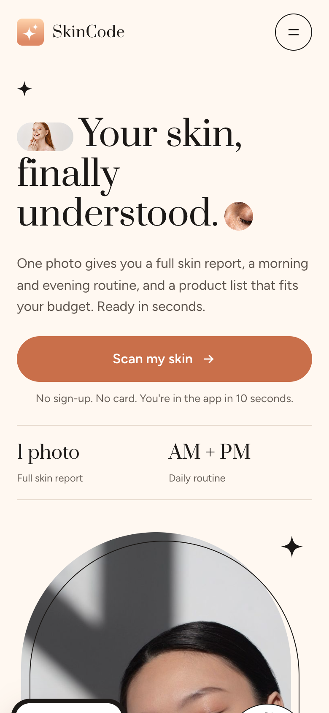
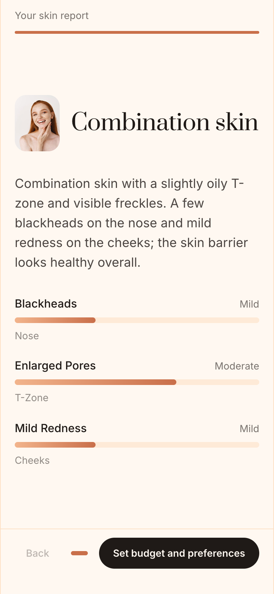
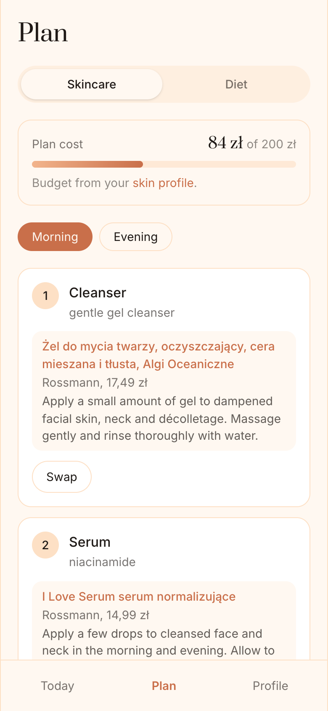
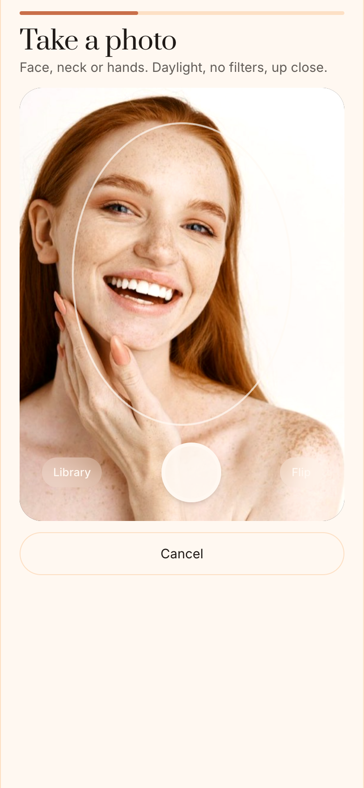
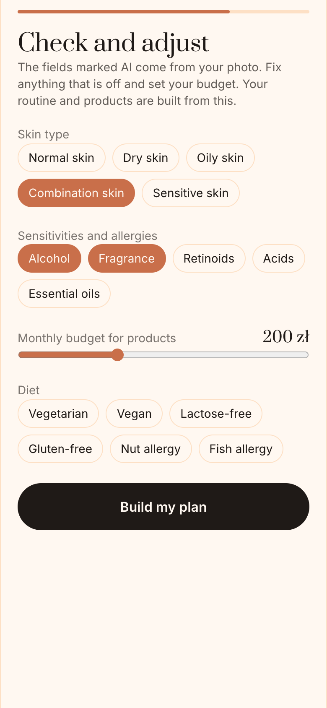
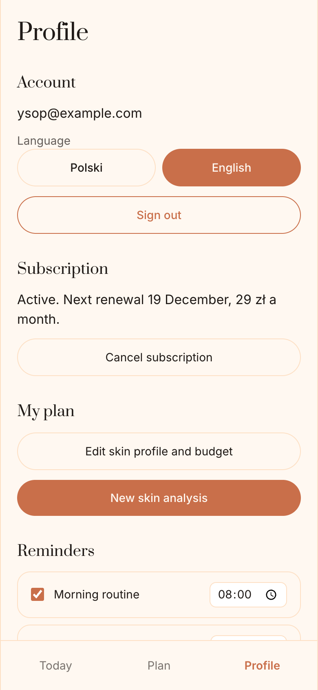

# SkinCode — pielęgnacja skóry z jednego zdjęcia

SkinCode to aplikacja PWA, która na podstawie jednego zdjęcia skóry przygotowuje raport, poranną i wieczorną rutynę pielęgnacyjną, listę produktów w zadanym budżecie oraz listę produktów spożywczych wspierających skórę. Analizę zdjęcia i dobór planu wykonuje model Claude (Anthropic) z odpowiedziami walidowanymi schematami Zod.

Aplikacja ma charakter kosmetyczny, nie medyczny: opisuje wygląd skóry i proponuje pielęgnację, a przy zmianach wymagających konsultacji odsyła do dermatologa.

<p align="center">
  
  
  
</p>

## Jak to działa

1. **Zdjęcie** — użytkownik robi zdjęcie twarzy, szyi lub dłoni aparatem w przeglądarce albo wybiera je z galerii. Zdjęcie jest kompresowane po stronie klienta.
2. **Raport** — model ocenia jakość zdjęcia, typ skóry i widoczne problemy (z obszarem i nasileniem), wskazuje składniki do unikania i w razie potrzeby zaleca wizytę u dermatologa.
3. **Profil** — użytkownik poprawia typ skóry, zaznacza wrażliwości i alergie, ustala miesięczny budżet i ograniczenia dietetyczne.
4. **Plan** — powstaje rutyna rano i wieczorem (do trzech kroków każda) z produktami dobranymi z katalogu i sklepów internetowych, z kosztem w odniesieniu do budżetu. Każdy produkt można podmienić.
5. **Dieta** — lista produktów „jedz więcej” i „ogranicz” z uzasadnieniem, zgodna z ograniczeniami dietetycznymi.
6. **Profil konta** — język (PL/EN), subskrypcja, przypomnienia o rutynie, eksport i usunięcie danych.

Płatność za subskrypcję jest symulowana (animowany mock, bez operatora płatności).

## Zrzuty ekranu

| Zdjęcie | Raport | Profil skóry | Dostęp |
| --- | --- | --- | --- |
|  |  |  |  |

| Plan pielęgnacji | Dieta | Konto | Strona główna |
| --- | --- | --- | --- |
|  |  |  |  |

## Technologie

- **Next.js 16** (App Router, Server Actions), **React 19**, **TypeScript**
- **Tailwind CSS 4**
- **Anthropic SDK** — analiza zdjęcia, rutyna, wyszukiwanie produktów (web search) i dieta, structured output przez **Zod 4**
- **Turso / libSQL** — konta, sesje i stan subskrypcji
- **PWA** — manifest, service worker, instalacja na ekranie głównym, przypomnienia
- Dwa języki interfejsu: polski i angielski (`src/i18n`)

## Struktura

```
src/
  app/
    (landing)/          strona główna pod /
    (pwa)/aplikacja/    aplikacja: logowanie, onboarding (start/*) i zakładki (dzis, plan, profil)
    api/analyze         analiza zdjęcia
    api/routine         rutyna na podstawie raportu i profilu
    api/products        dobór produktów do kroków rutyny
    api/diet            lista żywieniowa
    actions/            server actions: konto, logowanie, subskrypcja
  components/           komponenty i hooki ekranów
  lib/                  logika domenowa: schematy analizy, plan, katalog, dieta, subskrypcja, baza
  i18n/                 tłumaczenia i obsługa języka
  data/catalog.json     katalog produktów (generowany przez scripts/build-catalog.mjs)
docs/                   notatki techniczne i zrzuty ekranu
```

## Uruchomienie lokalne

Wymagania: Node.js 20+ i pnpm 10.

```bash
pnpm install
cp .env.example .env.local
pnpm dev
```

W `.env.local` ustaw:

| Zmienna | Opis |
| --- | --- |
| `ANTHROPIC_API_KEY` | klucz API Anthropic, potrzebny do analizy, planu, produktów i diety |
| `ANTHROPIC_MODEL` | model do analizy, np. `claude-haiku-4-5`, `claude-sonnet-5-5`, `claude-opus-5-5` |
| `TURSO_DATABASE_URL` | adres bazy Turso; lokalnie wystarczy plik SQLite, np. `file:data/local.db` |
| `TURSO_AUTH_TOKEN` | token Turso; przy lokalnym pliku dowolna niepusta wartość |

Strona główna jest pod [http://localhost:3000](http://localhost:3000), aplikacja pod `/aplikacja`. Kamera, service worker i instalacja PWA wymagają HTTPS poza `localhost` (np. `next dev --experimental-https` albo tunel).

## Testy

```bash
pnpm test
```

Testy jednostkowe (`node:test`) obejmują logikę domenową w `src/lib` i `src/i18n`.

## Dokumentacja

- [docs/TECH-SETUP.md](docs/TECH-SETUP.md) — analiza techniczna MVP i architektura
- [docs/AI-INTEGRATION-BRIEF.md](docs/AI-INTEGRATION-BRIEF.md) — możliwe podejścia do obsługi wielu modeli AI
- [scope-mvp.md](scope-mvp.md) — zakres MVP i lista ekranów

## Licencja

Kod: MIT, zob. [LICENSE](LICENSE). Materiały poza kodem (grafiki, opisy, landing): CC BY 4.0, zob. [LICENSE-MATERIALS.md](LICENSE-MATERIALS.md).
