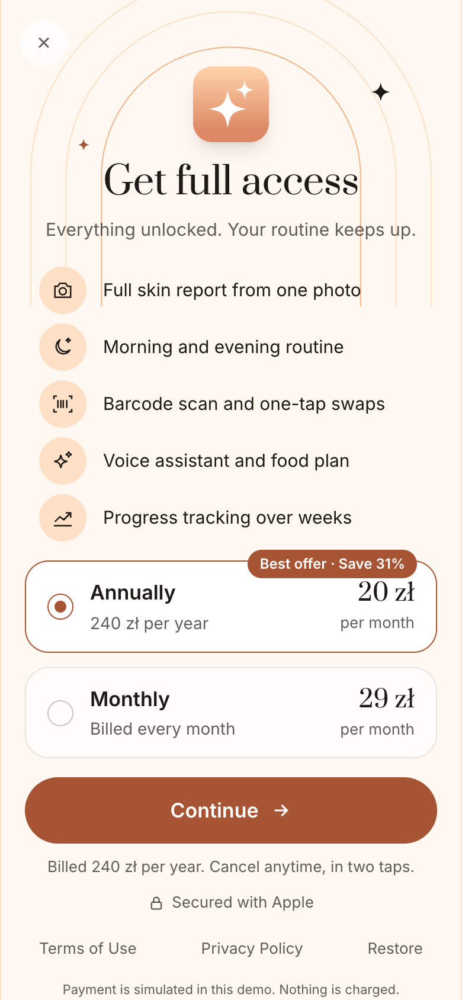
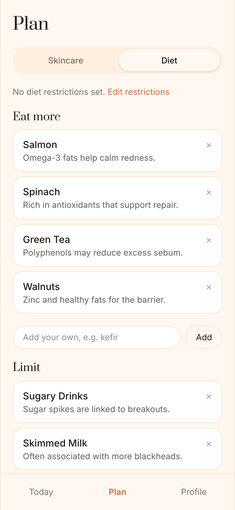

# SkinCode — skincare from a single photo

**English** | [Polski](README.pl.md)

[](https://github.com/lukasz-malicki-wrx/skincare/actions/workflows/ci.yml)

SkinCode is a progressive web app that turns one photo of your skin into a report, a morning and evening care routine, a product list within your budget and a list of foods that support your skin. The photo assessment and the plan come from Claude (Anthropic), with every response validated against Zod schemas.

The app gives cosmetic guidance, not a diagnosis: it describes how the skin looks and suggests care, and refers the user to a dermatologist when something needs a consultation.

<p align="center">
  
  
  
</p>

## How it works

1. **Photo** — the user takes a photo of their face, neck or hands with the browser camera, or picks one from the library. The photo is compressed on the device.
2. **Report** — the model checks the photo quality, the skin type and visible concerns (with area and severity), lists ingredients to avoid and, when needed, recommends a dermatologist.
3. **Profile** — the user corrects the skin type, marks sensitivities and allergies, and sets a monthly budget and diet restrictions.
4. **Plan** — a morning and evening routine (up to three steps each) with products picked from the catalogue and online shops, and its cost against the budget. Any product can be swapped.
5. **Diet** — "eat more" and "limit" lists with reasons, respecting the diet restrictions.
6. **Account** — language (EN/PL), subscription, routine reminders, data export and deletion.

The subscription payment is simulated (an animated mock, no payment provider).

## Screenshots

| Photo | Report | Skin profile | Access |
| --- | --- | --- | --- |
|  |  |  |  |

| Care plan | Diet | Account | Landing page |
| --- | --- | --- | --- |
|  |  |  |  |

## Tech stack

- **Next.js 16** (App Router, Server Actions), **React 19**, **TypeScript**
- **Tailwind CSS 4**
- **Anthropic SDK** — photo assessment, routine, product search (web search) and diet, structured output with **Zod 4**
- **Turso / libSQL** — accounts, sessions, subscription state and an append-only audit trail
- **Playwright + axe-core** — end-to-end tests and automated WCAG 2.1 AA checks
- **PWA** — manifest, service worker, home-screen install, reminders
- Two interface languages: English and Polish (`src/i18n`)

## How it is built

- **Server/client boundary.** The database, sessions, passwords and the Anthropic client import `"server-only"`. Rules the browser also needs (such as plan access) live in separate pure modules.
- **AI layer outside the routes.** Prompts, model calls and output validation (Zod, structured output) live in `src/lib/ai`. The routes in `src/app/api` only read the request and map the outcome to an HTTP response.
- **Client data.** One API client (`postJson`) with `AbortController` and translated error messages. The report, profile and plan live in `localStorage` behind `useSyncExternalStore`, and every read goes through a parser that turns corrupted data into a safe state.
- **Derived state is not stored.** The selected tab and time of day live in the URL (refresh and back keep them), and "products ready" is derived from the saved report.
- **Lazy loading.** The product dialog and the diet tab are separate chunks (`next/dynamic`). The dialog starts downloading when the user hovers or focuses a product.
- **Small, testable code.** One component per file, pure logic in separate `.ts` modules with tests, no import cycles.
- **Rendering.** Step cards are `memo` components with stable callbacks, and the list is memoised only where it pays off.
- **Accessibility.** WAI-ARIA tabs (keyboard, roving tabindex), native `<dialog>`, native radios and checkboxes, `role="alert"` for errors and `<output>` for status, form errors tied to their fields, animations only under `motion-safe`.
- **Resilience.** `error.tsx` in every app segment, `global-error.tsx`, `not-found.tsx`. Former Polish addresses redirect permanently (308) to the English ones.
- **Data integrity.** Sign-ins, subscription changes and account deletion go to an audit trail written in the same transaction as the change; the table cannot be edited or cleared.
- **Quality.** Unit and integration tests (`node:test`), end-to-end tests with axe on a production build, a requirement traceability check, SonarCloud, and CI on GitHub Actions with actions pinned to commit SHAs.

## Project structure

```
src/
  app/                    routing only: pages, layouts, route handlers, server actions
    (landing)/            landing page at /
    (pwa)/app/            the app at /app
      (auth)/             sign-in and sign-up with a shared layout
      start/              onboarding: photo, report, profile, paywall, plan
      (shell)/            tabs with the bottom navigation: today, plan, profile
    api/*/route.ts        thin model routes: analyze, routine, products, diet
    actions/              server actions: auth, account, subscription
  features/               screens and hooks by feature, one component per file
    analysis/camera/      camera and sending the photo for assessment
    analysis/report/      skin report and building the routine
    plan/, skin-profile/, account/, auth/, paywall/, today/, landing/
  components/             shared UI: Button, Text, Heading, Card, Input, TextLink,
                          Tabs, ChoiceChip, ProgressBar, Alert, icons, error screens
  hooks/                  shared hooks: localStorage, saved report, URL state
  lib/                    pure domain logic and schemas, with tests next to them
  lib/ai/                 Claude calls: client, prompts, validation, error handling
  i18n/                   EN/PL translations, price and date formatting, locale choice
  config/                 routes, navigation, brand tokens
  data/catalog.json       product catalogue (scripts/build-catalog.mjs)
e2e/                      end-to-end and WCAG 2.1 AA tests (Playwright, axe-core)
scripts/                  requirement traceability check, catalogue builder, test resolver
docs/compliance/          GxP and accessibility documentation
docs/screenshots/         README screenshots
.github/                  CI, CODEOWNERS, pull request template
```

## Running locally

Requirements: Node.js 22+ and pnpm 10.

```bash
pnpm install
cp .env.example .env.local
pnpm dev
```

Set in `.env.local`:

| Variable | Description |
| --- | --- |
| `ANTHROPIC_API_KEY` | Anthropic API key, needed for the assessment, plan, products and diet |
| `ANTHROPIC_MODEL` | model for the assessment, e.g. `claude-haiku-4-5`, `claude-sonnet-5-5`, `claude-opus-5-5` |
| `TURSO_DATABASE_URL` | Turso database URL; locally a SQLite file is enough, e.g. `file:data/local.db` |
| `TURSO_AUTH_TOKEN` | Turso token; any non-empty value for a local file |

The landing page is at [http://localhost:3000](http://localhost:3000) and the app at `/app`. The camera, service worker and PWA install need HTTPS outside `localhost` (for example `next dev --experimental-https` or a tunnel).

## Tests

```bash
pnpm test       # unit and integration tests (node:test)
pnpm check      # types, lint, tests and requirement traceability
pnpm build && pnpm test:e2e   # end-to-end and WCAG 2.1 AA tests on a production build
```

Unit tests sit next to the code (`*.test.ts`), end-to-end tests in `e2e/`. Every test that verifies a requirement starts its title with the requirement ID (for example `REQ-DI-02`). The end-to-end tests start their own server with a local SQLite database and mock the model calls, so they need no API key. Install the browser with `pnpm exec playwright install chromium`.

## Compliance (GxP, WCAG 2.1)

The project follows engineering practice for a regulated (GxP) environment and targets WCAG 2.1 AA. Requirements with IDs, the traceability matrix, the validation plan, the 21 CFR Part 11 / Annex 11 assessment, data integrity (ALCOA+) and the accessibility statement are in [docs/compliance](docs/compliance/README.md).

```bash
pnpm verify   # types, lint, tests, traceability, build, end-to-end and WCAG
```

## Documentation

- [docs/compliance](docs/compliance/README.md) — requirements, validation, data integrity, accessibility
- [CHANGELOG.md](CHANGELOG.md) — change history
- [SECURITY.md](SECURITY.md) — reporting a vulnerability
- [docs/TECH-SETUP.md](docs/TECH-SETUP.md) — MVP technical analysis and architecture (Polish)
- [docs/AI-INTEGRATION-BRIEF.md](docs/AI-INTEGRATION-BRIEF.md) — options for supporting several AI models (Polish)
- [docs/scope-mvp.md](docs/scope-mvp.md) — MVP scope and screen list (Polish)

## License

Code: MIT, see [LICENSE](LICENSE). Non-code materials (graphics, copy, landing page): CC BY 4.0, see [LICENSE-MATERIALS.md](LICENSE-MATERIALS.md).
