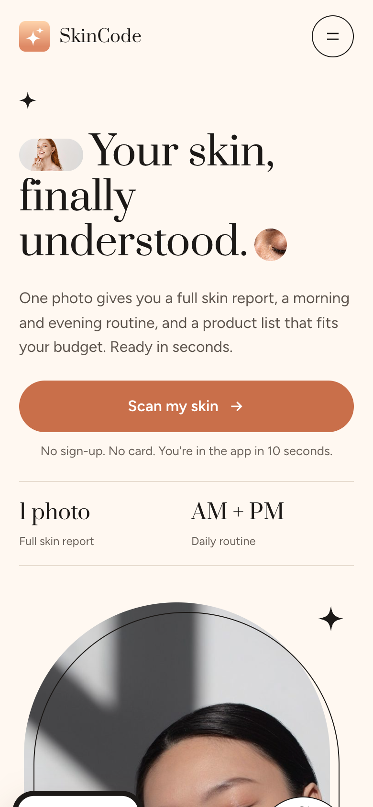
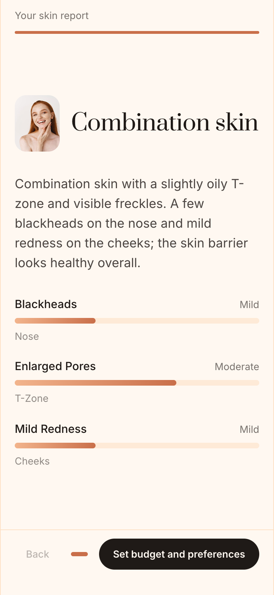
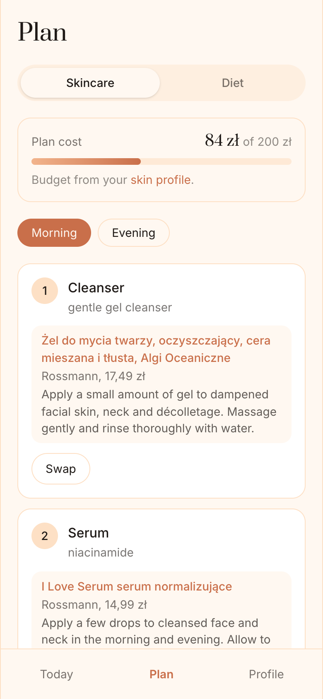
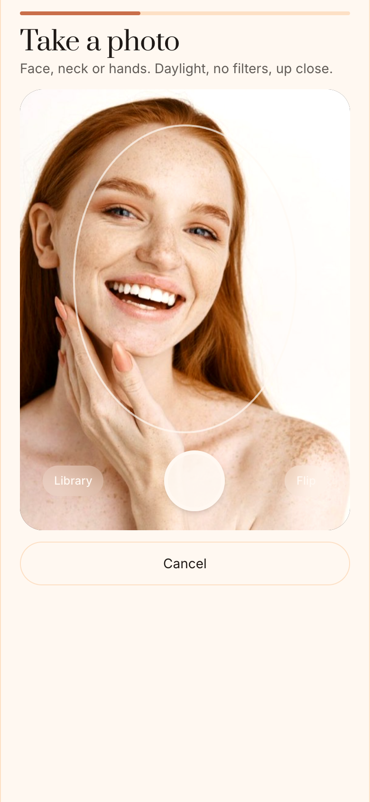
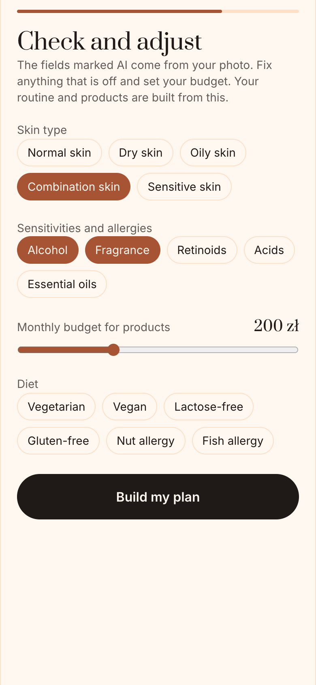
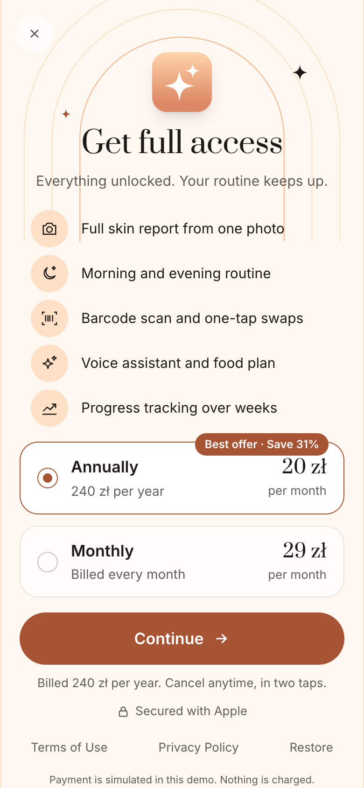
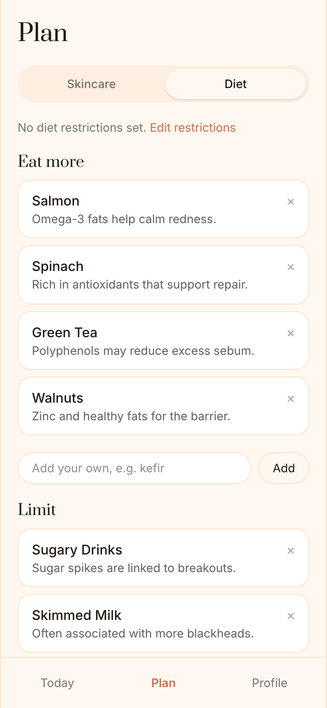
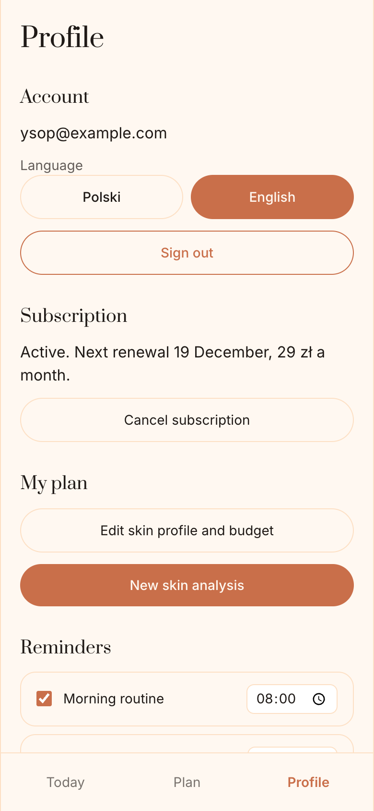

# SkinCode — pielęgnacja skóry z jednego zdjęcia

[English](README.md) | **Polski**

[](https://github.com/lukasz-malicki-wrx/skincare/actions/workflows/ci.yml)

SkinCode to aplikacja PWA, która na podstawie jednego zdjęcia skóry przygotowuje raport, poranną i wieczorną rutynę pielęgnacyjną, listę produktów w zadanym budżecie oraz listę produktów spożywczych wspierających skórę. Analizę zdjęcia i dobór planu wykonuje model Claude (Anthropic) z odpowiedziami walidowanymi schematami Zod.

Aplikacja ma charakter kosmetyczny, nie medyczny: opisuje wygląd skóry i proponuje pielęgnację, a przy zmianach wymagających konsultacji odsyła do dermatologa.

<p align="center">
  
  
  
</p>

## Jak to działa

1. **Zdjęcie** — użytkownik robi zdjęcie twarzy, szyi lub dłoni aparatem w przeglądarce albo wybiera je z galerii. Zdjęcie jest kompresowane po stronie klienta.
2. **Raport** — model ocenia jakość zdjęcia, typ skóry i widoczne problemy (z obszarem i nasileniem), wskazuje składniki do unikania i w razie potrzeby zaleca wizytę u dermatologa.
3. **Profil** — użytkownik poprawia typ skóry, zaznacza wrażliwości i alergie, ustala miesięczny budżet i ograniczenia dietetyczne.
4. **Plan** — powstaje rutyna rano i wieczorem (do trzech kroków każda) z produktami dobranymi z katalogu i sklepów internetowych, z kosztem w odniesieniu do budżetu. Każdy produkt można podmienić.
5. **Dieta** — lista produktów „jedz więcej” i „ogranicz” z uzasadnieniem, zgodna z ograniczeniami dietetycznymi.
6. **Profil konta** — język (PL/EN), subskrypcja, przypomnienia o rutynie, eksport i usunięcie danych.

Płatność za subskrypcję jest symulowana (animowany mock, bez operatora płatności).

## Zrzuty ekranu

| Zdjęcie | Raport | Profil skóry | Dostęp |
| --- | --- | --- | --- |
|  |  |  |  |

| Plan pielęgnacji | Dieta | Konto | Strona główna |
| --- | --- | --- | --- |
|  |  |  |  |

## Technologie

- **Next.js 16** (App Router, Server Actions), **React 19**, **TypeScript**
- **Tailwind CSS 4**
- **Anthropic SDK** — analiza zdjęcia, rutyna, wyszukiwanie produktów (web search) i dieta, structured output przez **Zod 4**
- **Turso / libSQL** — konta, sesje, stan subskrypcji i ścieżka audytu (tylko do dopisywania)
- **Playwright + axe-core** — testy end-to-end i automatyczne sprawdzanie WCAG 2.1 AA
- **PWA** — manifest, service worker, instalacja na ekranie głównym, przypomnienia
- Dwa języki interfejsu: polski i angielski (`src/i18n`)

## Jak to jest zbudowane

- **Granica serwer/klient.** Baza, sesje, hasła i klient Anthropic mają `import "server-only"`. Reguły potrzebne też w przeglądarce (np. dostęp do planu) są osobnymi, czystymi modułami.
- **Warstwa AI poza route'ami.** Prompty, wywołania modelu i walidacja wyniku (Zod, structured output) są w `src/lib/ai`. Endpointy w `src/app/api` tylko czytają żądanie i mapują wynik na odpowiedź HTTP.
- **Dane klienta.** Jeden klient API (`postJson`) z `AbortController` i tłumaczonymi komunikatami błędów. Raport, profil i plan siedzą w `localStorage` za `useSyncExternalStore`, a każdy zapis przechodzi przez parser, który zamienia uszkodzone dane na bezpieczny stan.
- **Stan, który da się wyliczyć, nie jest trzymany.** Wybrana zakładka i pora dnia są w URL (odświeżenie i „wstecz” je zachowują), a „produkty gotowe” wynika z zapisanego raportu.
- **Lazy loading.** Dialog produktu i zakładka diety to osobne chunki (`next/dynamic`). Dialog zaczyna się pobierać już po najechaniu na produkt lub ustawieniu na nim fokusu.
- **Mały, testowalny kod.** Jeden komponent na plik, czysta logika w osobnych modułach `.ts` z testami, brak cykli importów.
- **Renderowanie.** Karty kroków to komponenty `memo` ze stabilnymi callbackami, a lista jest memoizowana tylko tam, gdzie się to opłaca.
- **Dostępność.** Zakładki zgodne z WAI-ARIA (klawiatura, roving tabindex), natywny `<dialog>`, natywne radio i checkboxy, `role="alert"` dla błędów i `<output>` dla statusów, powiązane błędy formularzy, animacje tylko przy `motion-safe`.
- **Odporność.** `error.tsx` w każdym segmencie aplikacji, `global-error.tsx`, `not-found.tsx`. Stare polskie adresy przekierowują na nowe (308).
- **Integralność danych.** Logowanie, zmiany subskrypcji i usunięcie konta trafiają do ścieżki audytu, zapisywanej w tej samej transakcji co zmiana; tabeli nie da się edytować ani czyścić.
- **Jakość.** Testy jednostkowe i integracyjne (`node:test`), testy e2e z axe na buildzie produkcyjnym, sprawdzanie identyfikowalności wymagań, SonarCloud i CI na GitHub Actions z akcjami przypiętymi do SHA.

## Struktura

```
src/
  app/                    tylko routing: strony, layouty, endpointy, server actions
    (landing)/            strona główna pod /
    (pwa)/app/            aplikacja pod /app
      (auth)/             logowanie i rejestracja ze wspólnym layoutem
      start/              onboarding: photo, report, profile, paywall, plan
      (shell)/            zakładki z dolną nawigacją: today, plan, profile
    api/*/route.ts        cienkie endpointy modeli: analyze, routine, products, diet
    actions/              server actions: logowanie, konto, subskrypcja
  features/               ekrany i hooki według funkcji, jeden komponent na plik
    analysis/camera/      aparat, wysłanie zdjęcia do analizy
    analysis/report/      raport skóry i budowa rutyny
    plan/, skin-profile/, account/, auth/, paywall/, today/, landing/
  components/             wspólne komponenty UI: Button, Text, Heading, Card, Input,
                          TextLink, Tabs, ChoiceChip, ProgressBar, Alert, ikony, ekrany błędów
  hooks/                  wspólne hooki: localStorage, zapisany raport, stan w URL
  lib/                    czysta logika domenowa i schematy z testami obok
  lib/ai/                 wywołania Claude: klient, prompty, walidacja, obsługa błędów
  i18n/                   tłumaczenia PL/EN, formatowanie cen i dat, wybór języka
  config/                 ścieżki, nawigacja, tokeny marki
  data/catalog.json       katalog produktów (scripts/build-catalog.mjs)
e2e/                      testy end-to-end i WCAG 2.1 AA (Playwright, axe-core)
scripts/                  sprawdzanie identyfikowalności wymagań, budowa katalogu, resolver testów
docs/compliance/          dokumentacja GxP i dostępności (po angielsku)
docs/screenshots/         zrzuty ekranu z README
.github/                  CI, CODEOWNERS, szablon pull requesta
```

## Uruchomienie lokalne

Wymagania: Node.js 22+ i pnpm 10.

```bash
pnpm install
cp .env.example .env.local
pnpm dev
```

W `.env.local` ustaw:

| Zmienna | Opis |
| --- | --- |
| `ANTHROPIC_API_KEY` | klucz API Anthropic, potrzebny do analizy, planu, produktów i diety |
| `ANTHROPIC_MODEL` | model do analizy, np. `claude-haiku-4-5`, `claude-sonnet-5-5`, `claude-opus-5-5` |
| `TURSO_DATABASE_URL` | adres bazy Turso; lokalnie wystarczy plik SQLite, np. `file:data/local.db` |
| `TURSO_AUTH_TOKEN` | token Turso; przy lokalnym pliku dowolna niepusta wartość |

Strona główna jest pod [http://localhost:3000](http://localhost:3000), aplikacja pod `/app`. Kamera, service worker i instalacja PWA wymagają HTTPS poza `localhost` (np. `next dev --experimental-https` albo tunel).

## Testy

```bash
pnpm test       # testy jednostkowe i integracyjne (node:test)
pnpm check      # typy, lint, testy i identyfikowalność wymagań
pnpm build && pnpm test:e2e   # testy e2e i WCAG 2.1 AA na buildzie produkcyjnym
```

Testy jednostkowe leżą obok kodu (`*.test.ts`), testy e2e w `e2e/`. Nazwa każdego testu weryfikującego wymaganie zaczyna się od jego identyfikatora (np. `REQ-DI-02`). Testy e2e same uruchamiają serwer z lokalną bazą SQLite i mockują wywołania modelu, więc nie potrzebują klucza API. Przeglądarkę instaluje `pnpm exec playwright install chromium`.

## Zgodność (GxP, WCAG 2.1)

Projekt jest prowadzony według praktyk dla środowiska regulowanego GxP i celuje w WCAG 2.1 AA. Wymagania z identyfikatorami, macierz identyfikowalności, plan walidacji, ocena 21 CFR Part 11 / Annex 11, integralność danych (ALCOA+) i deklaracja dostępności są w [docs/compliance](docs/compliance/README.md) (po angielsku).

```bash
pnpm verify   # typy, lint, testy, identyfikowalność, build, e2e i WCAG
```

## Dokumentacja

- [docs/TECH-SETUP.md](docs/TECH-SETUP.md) — analiza techniczna MVP i architektura
- [docs/AI-INTEGRATION-BRIEF.md](docs/AI-INTEGRATION-BRIEF.md) — możliwe podejścia do obsługi wielu modeli AI
- [docs/scope-mvp.md](docs/scope-mvp.md) — zakres MVP i lista ekranów
- [docs/compliance](docs/compliance/README.md) — wymagania, walidacja, integralność danych, dostępność
- [CHANGELOG.md](CHANGELOG.md) — historia zmian
- [SECURITY.md](SECURITY.md) — zgłaszanie podatności

## Licencja

Kod: MIT, zob. [LICENSE](LICENSE). Materiały poza kodem (grafiki, opisy, landing): CC BY 4.0, zob. [LICENSE-MATERIALS.md](LICENSE-MATERIALS.md).
